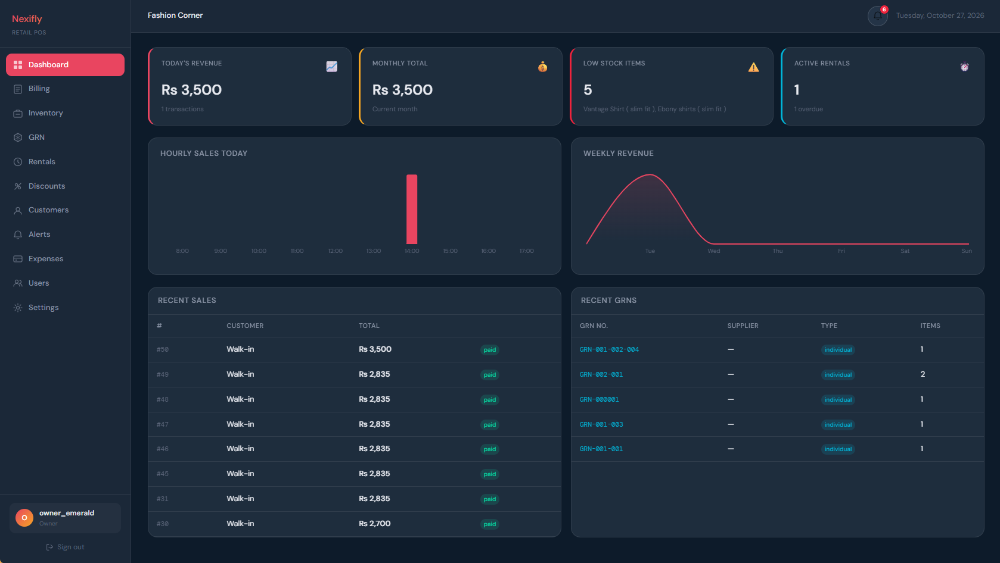
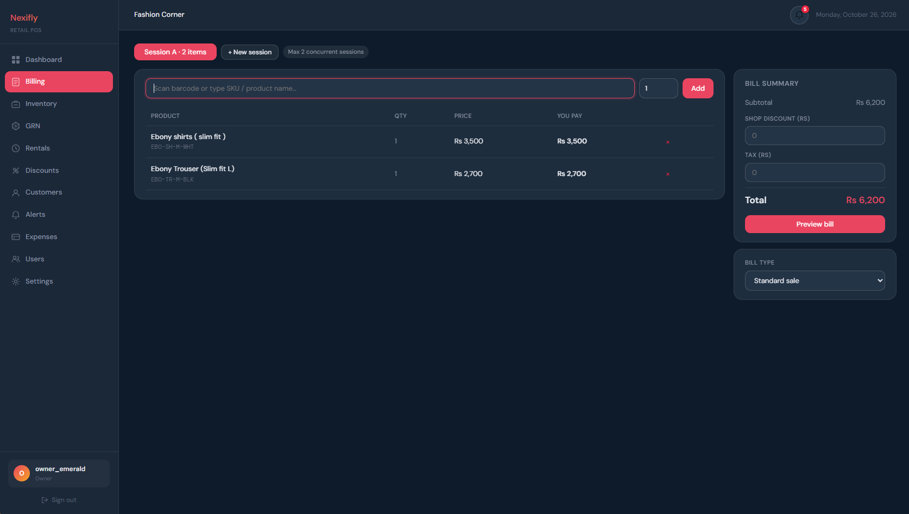
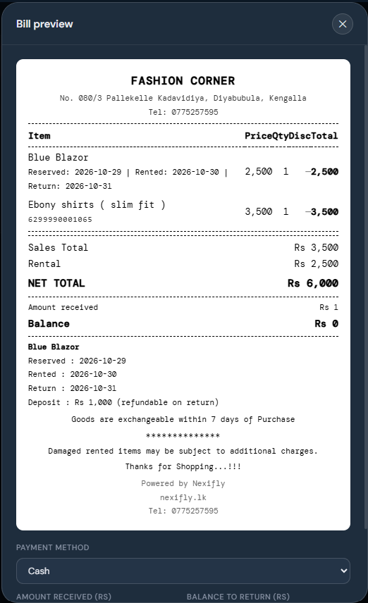
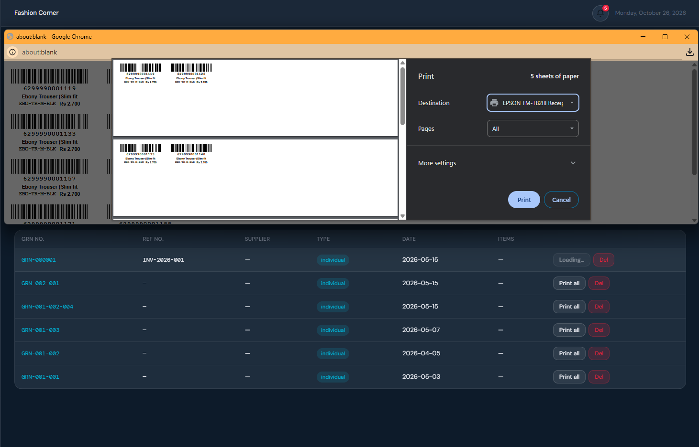
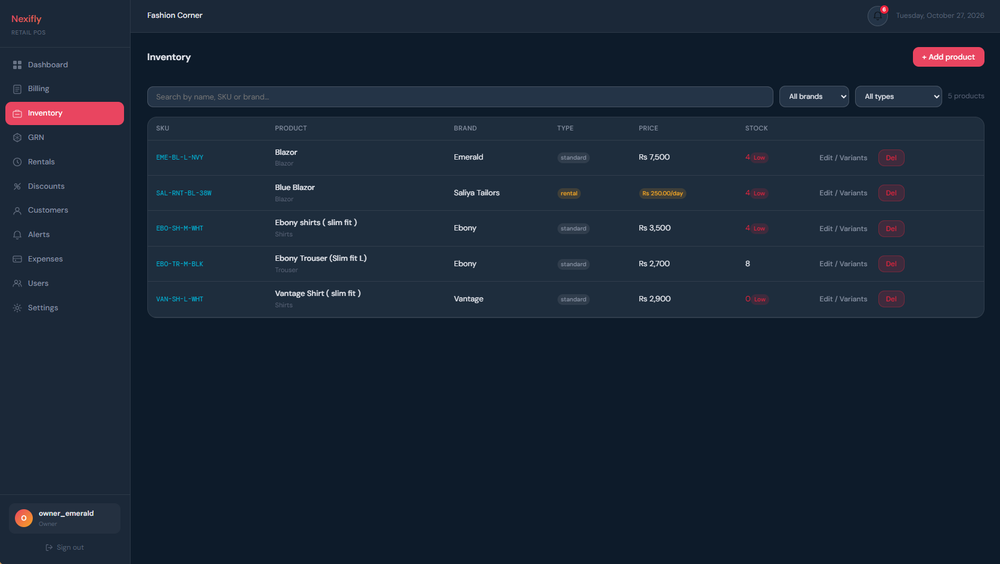
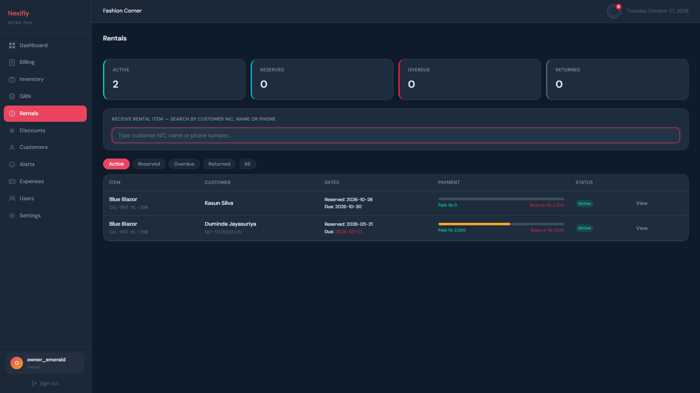
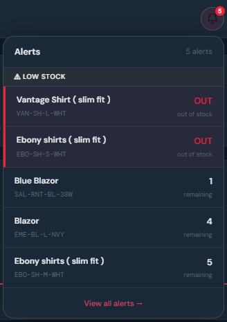
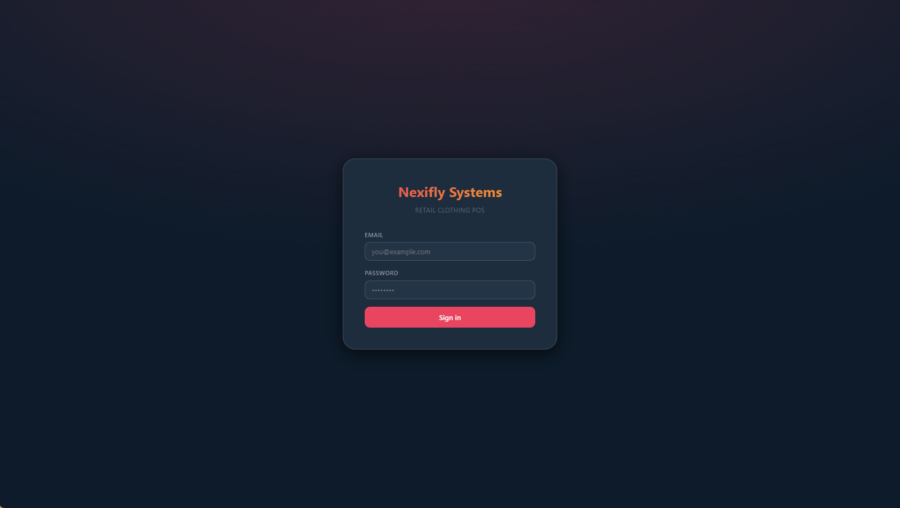

# Nexifly POS

A multi-branch point-of-sale and inventory system for clothing retailers, covering sales, rentals, stock receiving, discounts, expenses, and reporting.

**Built end-to-end through AI-directed development with Claude.** I defined the requirements, data model, and architecture, then guided Claude step by step, reviewing, testing, and debugging the generated code and adding features iteratively. See [How it was built](#how-it-was-built).

## Screenshots

### Dashboard
Daily and monthly revenue, low-stock items, active and overdue rentals, hourly and weekly sales charts, and recent sales and GRNs.



### Billing
Scan a barcode or search by SKU or name. Up to two billing sessions can run at once, with shop discount and tax.



| Bill preview and payment | Barcode label printing |
|---|---|
|  |  |
| Receipt with item barcodes, payment method, amount received and balance to return. | EAN-13 labels generated from each GRN, printed in bulk to a label or receipt printer. |

### Inventory
Products by brand and type (standard or rental), with prices, variants and low-stock highlighting.



### Rentals
Reservations with due dates, payment progress (paid and balance), and status tracking from reservation to return.



| Alerts | Login |
|---|---|
|  |  |
| Notification bell with low-stock and out-of-stock alerts. | Role-based sign-in for admins, owners and staff. |

## Features

- **Billing:** barcode and SKU scanning, multiple concurrent billing sessions, cash, card and bank-transfer payments with change calculation, and printed receipts with the shop logo and a bill barcode
- **Fabric sales:** fabric sold by length in meters or yards, with stock tracked per roll and per meter
- **Rentals:** reservations with date-overlap checks, advance and installment payments, and returns
- **Inventory:** products with size, colour, material and style variants, using searchable pickers where new values are created on first use
- **Stock receiving (GRN):** automatic GRN numbers, supplier invoice references, EAN-13 barcode generation, and label printing (USB and Zebra GT800)
- **Discounts:** seasonal and bulk discounts
- **Customers:** customer records with loyalty tiers and points
- **Expenses:** expense logging with an owner approval workflow
- **Dashboard and alerts:** daily, monthly and 7-day sales, low-stock and out-of-stock alerts, overdue and upcoming rentals, and a notification bell
- **Multi-branch and roles:** platform admins, shop owners, and branch staff (manager, cashier), each with their own permissions
- **Safe deletion:** products with sales or rental history can't be deleted, which protects financial records

## Tech stack

| Layer | Technology |
|---|---|
| Frontend | React 18, Vite, React Router 7, Axios, Recharts |
| Backend | Node.js, Express, JWT authentication, bcrypt password hashing |
| Database | PostgreSQL (46 tables, transactional writes with savepoints for non-critical audit entries) |

## Project structure

```
nexifly-pos/
├── backend/          Express REST API (modules: platform, branch, product, grn, billing, rental)
│   └── scripts/      create-super-admin.js
├── frontend/         React app (pages, components, auth context, API client)
├── database/
│   ├── schema.sql    Full database structure
│   └── seed.sql      Reference data (product types, units, plans)
└── docs/screenshots/
```

## Getting started

**Requirements:** Node.js 22.12 or newer and PostgreSQL 14+.

### 1. Database

```bash
createdb nexifly_pos
psql -d nexifly_pos -f database/schema.sql
psql -d nexifly_pos -f database/seed.sql
```

### 2. Backend

```bash
cd backend
npm install
cp .env.example .env      # then edit .env: set DB_PASSWORD and a long random JWT_SECRET
npm run create-admin -- --email admin@example.com --username admin --password "YourStrongPassword"
npm run dev               # API on http://localhost:4000
```

### 3. Frontend

```bash
cd frontend
npm install
npm start                 # app on http://localhost:3000
```

Log in with the Super Admin account you created, then create a shop owner and branch from the admin screens.

## How it was built

This project was built through AI-directed development: I worked as the architect, reviewer, and tester, and Claude wrote code under my direction. My role included:

- Defining requirements for a real clothing store, including rentals, barcode workflows, and multi-branch operation
- Designing the data model and the module structure of the API
- Guiding implementation step by step, one feature at a time
- Reviewing and testing each feature, finding and fixing bugs, and adding features iteratively

## Author

**Duminda Jayasuriya**, Software Engineer · [LinkedIn](https://www.linkedin.com/in/duminda-jayasuriya-386761149)